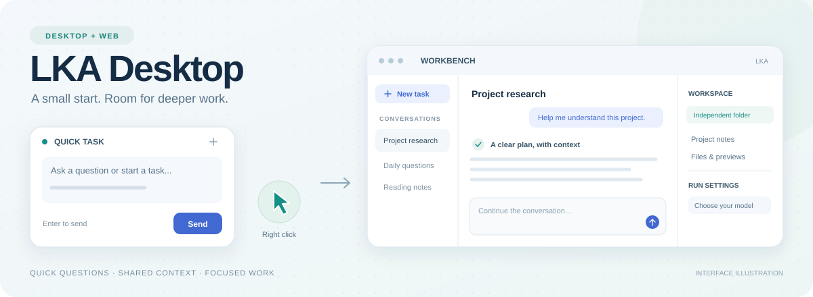
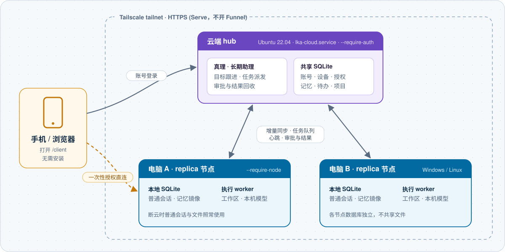

<div align="center">



<h1>理事所 · LKA Desktop</h1>

<p>
LKA 的桌面与浏览器前端。<br>
Windows 桌宠负责快速提问，工作台用于会话、文件、项目、记忆和消息。
</p>

<p>


</p>

<p>
<a href="#overview">概览</a> ·
<a href="#ui">界面</a> ·
<a href="#deployment">部署结构</a> ·
<a href="#quickstart">快速开始</a> ·
<a href="#qq">QQ 接入</a> ·
<a href="#dev">开发</a> ·
<a href="#docs">文档</a>
</p>

</div>

---

<br>

<a id="overview"></a>

## 🧭 概览

理事所是应用名，真理是桌宠角色的名字。点击桌宠默认进入与真理的持续对话，
需要单独处理一件事时选「新任务」；长回复、文件和项目任务转到工作台继续，会话是同一个。

本仓库包含：

- 共享的聊天界面、桌面工作台和移动工作台（原生 HTML / CSS / JS，无打包步骤）
- Java 21 桌宠与原生窗口桥接（Spine 动画）
- Python 前端服务：静态页面、后端接口白名单转发、云端登录代理、可选 QQ 插件

对话生成、工具执行、记忆和消息分析由 [LKA Backend](https://github.com/Viottery/lka-backend) 完成。

<br>

<a id="ui"></a>

## ✦ 界面

<table>
<tr>
<td width="33%" valign="top">

<h4>🪶 桌宠与快速窗口</h4>
拖动、点击、双击互动；右键打开快速窗口，以对话和待处理提醒为主

</td>
<td width="33%" valign="top">

<h4>🖥️ 工作台</h4>
会话列表、工作区、运行设置可分别收起；Markdown 渲染，查看执行过程与运行记录

</td>
<td width="33%" valign="top">

<h4>🧑‍💼 真理</h4>
持续对话、待处理、目标与交付记录；回复期间可连续发送，消息按顺序处理

</td>
</tr>
<tr>
<td width="33%" valign="top">

<h4>⏯️ 任务控制</h4>
普通任务可暂停、继续，或暂停后发送新指令接替；后端要求审查时在界面确认

</td>
<td width="33%" valign="top">

<h4>📎 附件输入</h4>
图片、PDF、Office、表格、Markdown，每轮最多 4 个，预览后与文字一起发送

</td>
<td width="33%" valign="top">

<h4>📁 工作区与文件</h4>
首次写入时才创建目录；浏览电脑目录、切换工作区、上传与下载

</td>
</tr>
<tr>
<td width="33%" valign="top">

<h4>🧠 记忆 · 项目 · 待办</h4>
项目对应一个文件夹并共享项目记忆；待办支持日历和分阶段规划，删除可撤销

</td>
<td width="33%" valign="top">

<h4>💬 消息中心</h4>
会话浏览、检索、话题与重要信息，打开原消息及前后记录

</td>
<td width="33%" valign="top">

<h4>📱 移动工作台</h4>
手机用会话抽屉和底部导航，平板保留侧栏；功能与桌面一致

</td>
</tr>
</table>

模型和推理档位在输入框下方切换，并保存为默认值。删除的会话进入回收站，可恢复。
打开已有会话时会恢复进行中的任务进度流。

<br>

<a id="deployment"></a>

## ☁️ 部署结构

前端可以连接单机后端，也可以接入云端 hub 和多台电脑节点。

<p align="center">

</p>

在每台 Windows 电脑上，桌宠、浏览器工作台和可选的 QQ 插件都经本机前端服务（:8780）访问 loopback 后端（:8765），这个后端就是图中的节点。

| 位置 | 提供什么 |
| :--- | :--- |
| 本机工作台（:8780） | 全部功能，含消息中心与 QQ；设置 `LKA_CLOUD_ORIGIN` 后可登录云端，顶栏出现位置菜单 |
| 云端页面 | 真理、待办、项目、记忆，以及「设备与账号」面板；不含消息与 QQ |
| 节点页面 | 该电脑的普通会话和工作区文件，真理与待办来自云端；新运行强制人工审查 |
| 仅客户端模式 | `LKA_CLIENT_MODE=cloud`，不启动本机后端，所有请求经前端服务转到云端 |

- 云端和每台电脑在各自的 HTTPS 地址托管 `app/web/pet`：后端设置 `[client].workbench_dir`，或用 Tailscale Serve / 反向代理把 `/desktop-pet/` 指向该目录。
- 统一入口是云端的 `/desktop-pet/connect.html`。顶栏位置菜单列出云端和已登记电脑，选择后直接申请授权跳转。
- 登录保存在 HttpOnly cookie；Windows 可用 `LKA_CLOUD_SESSION_PATH` 以 DPAPI 加密保存云端会话，不保存密码。
- 云端离线时，入口会列出这个浏览器进入过的设备，连接有效的仍可直接打开。

细节见 [多端协同](docs/multi-device.md) 与 [部署说明](docs/deployment.md)。

<br>

<a id="quickstart"></a>

## 🚀 快速开始

需要 Windows 与 Python 3.12+，桌宠另需 Java 21。先按
[后端 README](https://github.com/Viottery/lka-backend#readme) 启动后端。
> [!NOTE]
> 以下命令在本仓库根目录的 PowerShell 中执行。

#### ① 安装依赖

```powershell
python -m venv .venv
.\.venv\Scripts\python.exe -m pip install -r requirements.txt
if (-not (Test-Path .env)) { Copy-Item .env.example .env }
```

#### ② 确认后端可访问

```powershell
Invoke-RestMethod http://127.0.0.1:8765/health
```

#### ③ 启动

```powershell
# 只用浏览器
.\run-lka-windows.ps1 -NoBackend -NoPet -OpenBrowser

# 桌宠（首次需编译）
.\scripts\setup-java-env.ps1
.\desktop-pet-java\gradlew.bat -p desktop-pet-java compileJava
.\run-lka-windows.ps1 -NoBackend
```

工作台地址：
`http://127.0.0.1:8780/desktop-pet/chat.html?mode=work&backend=http%3A%2F%2F127.0.0.1%3A8765`；
移动布局：`/desktop-pet/mobile.html`。后端不在默认地址时用 `-BackendHost`、`-BackendPort`，
前端端口用 `-FrontendPort`。

<details>
<summary><strong>其他启动方式</strong></summary>

由启动器在 WSL 中启动后端（默认 `~/lka_backend`，可用 `-BackendRoot` 指定）：

```powershell
.\run-lka-windows.ps1 -WslDistro Ubuntu -OpenBrowser
```

全部原生 Windows 运行，见 [原生运行说明](docs/windows-native-runtime-guide.md)：

```powershell
.\run-lka-native-windows.ps1 -BackendRoot C:\Projects\lka_backend
```

后端配置为 replica 节点时可加 `-RequireNode`。

</details>

> [!TIP]
> **更新**：`Check-LKA-Update.cmd` 检查版本，任务结束并退出前端后运行 `Update-LKA.cmd`。
> 默认只更新前端，配置、数据库和配对凭据保留在本机。见 [Windows 更新](docs/windows-updates.md)。

| 配置项 | 位置 |
| :--- | :--- |
| 前端本机配置 | `.env`（模型配置在后端） |
| 默认工作区父目录 | 界面设置或 `LKA_SESSION_WORKSPACE_BASE`，默认 `文档/Local Knowledge Agent/Workspaces` |
| 消息中心配对 | `.runtime/message-control.dpapi` 或 `-MessageControlCredentialPath`；凭据只传给 Python，不进 Java 和页面 |
| 云端 | `LKA_CLOUD_ORIGIN`、`LKA_CLOUD_SESSION_PATH` |

<br>

<a id="qq"></a>

## 🔌 QQ 接入（可选，默认关闭）

Windows 侧 Python 插件连接本机 OneBot WebSocket，把标准化消息写入前端本地 SQLite，
再通过鉴权接口同步到后端。后端离线时消息留在本机，恢复后幂等补送；宿主断线期间的消息不保证补回。

```powershell
.\.venv\Scripts\python.exe -m pip install -r requirements-qq-reader.txt
```

把 `.env.qq-reader.example` 中需要的项合并到 `.env`，见 [Reader 插件说明](docs/qq_reader_plugin_delivery_2026-10-02.md)。

- **分开启用**：采集和发送分别启用；发送接口支持文字、图片、视频和表情，见 [消息接口](docs/qq_messaging_interfaces_2026-10-04.md)。
- **只读**：Agent 的 QQ 工具是只读的，前端有发送接口不代表 Agent 能发送、撤回或管理。
- **凭据隔离**：浏览器不直接连接 OneBot，也接触不到它的 Token。Windows 与 WSL 各自管理 SQLite。

<br>

<a id="dev"></a>

## 🧩 开发

| 目录 | 职责 |
| :--- | :--- |
| `app/web/pet/` | 聊天界面、工作台、移动布局、消息中心、样式与资源 |
| `desktop-pet-java/` | 桌宠、原生窗口与消息桥接 |
| `app/main.py` · `app/api/routes/` · `app/plugins/` | 前端服务、后端适配接口、QQ 插件 |
| `data/pet/profiles.json` | 角色、资源和动作定义 |
| `scripts/` · `tests/` | 环境准备、启动辅助、仓库检查、回归测试 |

`app/agent/`、`app/rag/`、`app/runtime/` 为兼容模块，仍被入口引用，日常对话走独立后端。

按修改的层选择检查：

```powershell
# 仓库检查（暂存内容与历史中的运行数据、密钥）
.\.venv\Scripts\python.exe scripts/check-repository.py --staged --history

# Python
.\.venv\Scripts\python.exe -m pytest tests/test_qq_reader.py tests/test_qq_actions.py tests/test_message_reading_proxy.py -q

# Java
.\desktop-pet-java\gradlew.bat -p desktop-pet-java compileJava verifyPetMotion verifyPetInteraction verifyPetMemoryBridge

# 浏览器回归（Node.js + Chrome，合成 HTTP 服务）
npm ci
npm run test:chat
npm run test:sessions
npm run test:mobile
```

其他浏览器测试有 `test:projects`、`test:matters`、`test:messages`；Chrome 路径用 `CHROME_PATH` 指定。
后端新增接口时，更新 `tests/fixtures/backend_routes.json` 并运行
`python -m unittest tests.test_workbench_route_sync`，前端转发层只放行白名单接口。

<br>

<a id="docs"></a>

## 📖 文档

| 主题 | 文档 |
| :--- | :--- |
| 安装与部署 | [deployment](docs/deployment.md) · [windows-native-runtime-guide](docs/windows-native-runtime-guide.md) · [windows-updates](docs/windows-updates.md) |
| 多端协同 | [multi-device](docs/multi-device.md) · [mobile-workbench](docs/mobile-workbench.md) |
| 桌宠 | [desktop-pet-entry](docs/desktop-pet-entry.md) · [windows-pet-frontend](docs/windows-pet-frontend.md) |
| 真理与任务控制 | [global-assistant](docs/global-assistant.md) · [run-controls](docs/run-controls.md) |
| 文件与工作区 | [workspace-files](docs/workspace-files.md) · [workspace-browser](docs/workspace-browser.md) · [image-input](docs/image-input.md) |
| 待办 | [matters](docs/matters.md) |
| 消息 | [message_history_frontend](docs/message_history_frontend.md) · [QQ 接口](docs/qq_messaging_interfaces_2026-10-04.md) |
| 仓库范围与隐私检查 | [repository_delivery](docs/repository_delivery.md) |

带日期的文档是各阶段交付记录，当前安装方式以本 README 为准。

## 📜 数据与许可

真实配置、密钥、会话数据、QQ 数据库、媒体缓存和日志不进入 Git。使用远程模型时，
对话与选中的上下文会发送给所配置的模型服务。

角色及部分图标来自《明日方舟》相关资源，权益归原权利人所有。Spine、ArkPets、Pixi、
Markdown-it 等第三方组件遵循各自许可，见仓库内保留的授权文件。本仓库未对现有代码和第三方资源统一授予新的开源许可。

---

<div align="center">
<sub>理事所 · LKA Desktop · 后端见 <a href="https://github.com/Viottery/lka-backend">LKA Backend</a></sub>
</div>
